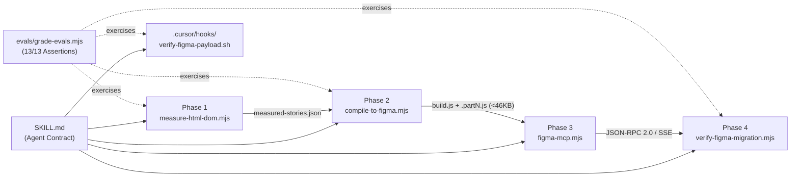

<a id="readme-top"></a>

<div align="center">

# `tooling-agent-skill-multi_html-to-figma`

<p>
  <strong>Deterministic HTML, CSS/SCSS, React &amp; Storybook to Native Figma Migration Skill</strong><br />
  <sub>Headless Chromium DOM geometry · Compact tuple wire compiler (<code>&lt;46 KB</code> chunks) · Figma MCP bridge · Automated parity verification</sub>
</p>

<p>
  <a href="https://github.com/AntonBronnfjell/tooling-agent-skill-multi_html-to-figma/blob/main/SKILL.md">
    
  </a>
  <a href="https://github.com/AntonBronnfjell/tooling-agent-skill-multi_html-to-figma/blob/main/evals/grading.json">
    
  </a>
  <a href="https://github.com/AntonBronnfjell/tooling-agent-skill-multi_html-to-figma/blob/main/package.json">
    
  </a>
  <a href="https://github.com/AntonBronnfjell/tooling-agent-skill-multi_html-to-figma/blob/main/.cursor/hooks.json">
    
  </a>
  <a href="https://github.com/AntonBronnfjell/tooling-agent-skill-multi_html-to-figma/blob/main/SKILL.md">
    
  </a>
</p>

<p>
  <a href="#-overview">Overview</a> ·
  <a href="#-architecture--4-phase-pipeline">Pipeline</a> ·
  <a href="#-quickstart--cli-workflow">Quickstart</a> ·
  <a href="#-dom-to-figma-node-anatomy">Node Anatomy</a> ·
  <a href="#-wire-format--deep-dives">Specs &amp; Internals</a> ·
  <a href="#-evaluation-suite--cursor-hooks">Evals &amp; Hooks</a>
</p>

</div>

<hr />

## 🎯 Overview

**`tooling-agent-skill-multi_html-to-figma`** is a zero-dependency agentic skill package that migrates rendered **HTML**, **CSS/SCSS Modules**, **React**, and **Storybook** applications into native, editable Figma `COMPONENT_SET` variants, variables, and composed screens with **1:1 visual, typographic, and token parity**.

Instead of statically guessing layout coordinates from CSS rules or emitting brittle absolute positions, this skill measures live DOM geometry in headless Chromium (`getBoundingClientRect()` and `Range.getClientRects()`), compiles nodes into an interned tuple wire format that respects the Figma MCP `<50,000`-character ceiling, and enforces deterministic pre- and post-push parity gates.

<table>
  <thead>
    <tr>
      <th align="left" width="50%">❌ Naive / Static HTML-to-Figma Approaches</th>
      <th align="left" width="50%">✅ <code>html-to-figma</code> Deterministic Pipeline</th>
    </tr>
  </thead>
  <tbody>
    <tr>
      <td valign="top">
        <ul>
          <li>Estimates text dimensions via heuristics (<code>text.length * 7</code>), causing clipped labels and broken line wraps.</li>
          <li>Passes raw <code>var(--token)</code> or <code>currentColor</code> strings into Figma constructors, resulting in silent fallback fills.</li>
          <li>Fails when <code>use_figma</code> scripts exceed the <code>50,000</code>-character MCP transport limit.</li>
          <li>Drops <code>::after</code> indicators, range slider thumbs, and React portals / fixed modals.</li>
        </ul>
      </td>
      <td valign="top">
        <ul>
          <li>Measures exact sub-pixel client rects and line counts in headless Chromium at a locked <code>748px</code> viewport.</li>
          <li>Resolves all CSS custom properties, <code>currentColor</code> SVG strokes, and 4-side borders before serialization.</li>
          <li>Interns strings/SVGs into lookup tables (<code>STRS[]</code>, <code>SVGS[]</code>) and auto-splits scripts into <code>&lt;46 KB</code> <code>.partN.js</code> chunks.</li>
          <li>Captures pseudo-elements, native inputs, inlined portals, and blocks invalid payloads via Cursor hooks.</li>
        </ul>
      </td>
    </tr>
  </tbody>
</table>

> [!IMPORTANT]
> **Design Principles**: Built on **Ponytail** (*stdlib-first, zero external runtime dependencies, compact tuple wire format, one runnable verification check per stage*) and **Agentic** (*explicit variant state coverage, resolved semantic tokens, and hard quality gates*).

<p align="right"><sub><a href="#readme-top">↑ Back to top</a></sub></p>

---

## 🏗️ Architecture & 4-Phase Pipeline



<table>
  <thead>
    <tr>
      <th align="left">Phase</th>
      <th align="left">Script</th>
      <th align="left">Responsibility</th>
      <th align="left">Verification Gate</th>
    </tr>
  </thead>
  <tbody>
    <tr>
      <td valign="top"><kbd>Phase 1</kbd></td>
      <td valign="top"><a href="scripts/measure-html-dom.mjs"><code>scripts/measure-html-dom.mjs</code></a></td>
      <td valign="top">Renders HTML files, live URLs, or Storybook static builds in headless Chromium; freezes animations; patches React portals &amp; fixed overlays; extracts boxes, SVGs, and text runs.</td>
      <td valign="top"><code>0</code> window errors, <code>0</code> unhandled rejections, <code>rootRect &gt;= 16px</code>, zero raw <code>var(--)</code> tokens.</td>
    </tr>
    <tr>
      <td valign="top"><kbd>Phase 2</kbd></td>
      <td valign="top"><a href="scripts/compile-to-figma.mjs"><code>scripts/compile-to-figma.mjs</code></a></td>
      <td valign="top">Deduplicates colors/shadows into <code>STRS[]</code> and inline SVGs into <code>SVGS[]</code>; emits compact tuple arrays and splits tall component sets into <code>.part2.js</code>, <code>.part3.js</code> chunks with <code>isAppend = true</code>.</td>
      <td valign="top">Every generated script part is strictly <code>&lt;= 46,000</code> characters with valid JSON tables.</td>
    </tr>
    <tr>
      <td valign="top"><kbd>Phase 3</kbd></td>
      <td valign="top"><a href="scripts/figma-mcp.mjs"><code>scripts/figma-mcp.mjs</code></a></td>
      <td valign="top">Communicates with the local Figma MCP server (<code>http://127.0.0.1:38450/mcp</code>) over JSON-RPC 2.0 / SSE to execute <code>use_figma</code> batches, inspect nodes, and save <code>/tmp/figma-migration-progress.json</code> checkpoints.</td>
      <td valign="top">Pre-blocked by <a href=".cursor/hooks/verify-figma-payload.sh"><code>verify-figma-payload.sh</code></a> if payload <code>&gt;50 KB</code> or contains unresolved tokens.</td>
    </tr>
    <tr>
      <td valign="top"><kbd>Phase 4</kbd></td>
      <td valign="top"><a href="scripts/verify-figma-migration.mjs"><code>scripts/verify-figma-migration.mjs</code></a></td>
      <td valign="top">Cross-checks every measured component and <code>Story=&lt;Variant&gt;</code> against compiled scripts and optional live Figma canvas state.</td>
      <td valign="top">Must exit <code>0</code> with <samp>STATUS: PASS</samp> and <code>100%</code> variant coverage.</td>
    </tr>
  </tbody>
</table>

<p align="right"><sub><a href="#readme-top">↑ Back to top</a></sub></p>

---

## 🏷️ Repository Naming Convention (`/repo-name-conventions`)

<table>
  <thead>
    <tr>
      <th align="left">Segment</th>
      <th align="left">Value</th>
      <th align="left">Taxonomy Role</th>
      <th align="left">Description</th>
    </tr>
  </thead>
  <tbody>
    <tr>
      <td><code>&lt;purpose&gt;</code></td>
      <td><kbd>tooling</kbd></td>
      <td>Domain Purpose</td>
      <td>Developer productivity, CLI automation, and design-engineering build pipelines.</td>
    </tr>
    <tr>
      <td><code>&lt;platform&gt;</code></td>
      <td><kbd>agent</kbd></td>
      <td>Target Runtime</td>
      <td>LLM coding agents (Cursor, Claude Code, Antigravity) &amp; MCP tool runtimes.</td>
    </tr>
    <tr>
      <td><code>&lt;repo-type&gt;</code></td>
      <td><kbd>skill</kbd></td>
      <td>Artifact Type</td>
      <td>Reusable agent skill package with <code>SKILL.md</code>, executable scripts, hooks, and evals.</td>
    </tr>
    <tr>
      <td><code>&lt;language&gt;</code></td>
      <td><kbd>multi</kbd></td>
      <td>Implementation</td>
      <td>Multi-language package combining Markdown contracts, Node ESM (<code>.mjs</code>), and Bash hooks (<code>.sh</code>).</td>
    </tr>
    <tr>
      <td><code>&lt;project-name&gt;</code></td>
      <td><kbd>html-to-figma</kbd></td>
      <td>Project Identifier</td>
      <td>Kebab-case descriptive domain separated by an underscore (<code>_</code>).</td>
    </tr>
  </tbody>
</table>

<p align="right"><sub><a href="#readme-top">↑ Back to top</a></sub></p>

---

## 🚀 Quickstart & CLI Workflow

### 1. Run Self-Tests & Deterministic Evals

No `npm install` is required—all scripts use the Node.js standard library (`node:fs`, `node:http`, `node:child_process`, `node:path`).

```bash
npm test
```

<details>
<summary><strong>View expected <samp>npm test</samp> output</strong></summary>

<br />

<pre><samp>{
  "ok": true,
  "storiesMeasured": 2,
  "sampleComponent": "Button",
  "sampleVariant": "Primary",
  "itemCount": 3
}
{
  "skill_name": "html-to-figma",
  "repository": "tooling-agent-skill-multi_html-to-figma",
  "summary": {
    "total_evals": 4,
    "passed_evals": 4,
    "total_assertions": 13,
    "passed_assertions": 13,
    "pass_rate": 1
  }
}</samp></pre>

</details>

### 2. End-to-End Migration Commands

```bash
# Phase 1A — Measure an HTML document with [data-component] and [data-story] nodes:
node scripts/measure-html-dom.mjs \
  --html path/to/index.html \
  --out /tmp/measured-stories.json

# Phase 1B — Or measure a Storybook static build by 1-based story index range:
node scripts/measure-html-dom.mjs \
  --storybook ./storybook-static \
  --range 1 30 \
  --out /tmp/measured-stories.json

# Phase 2 — Compile measured JSON into <46 KB chunked Figma plugin scripts:
node scripts/compile-to-figma.mjs \
  /tmp/measured-stories.json \
  ./build-batch.js \
  230 \
  --page "52:2"

# Phase 3 — Push compiled scripts (and any .partN.js chunks) via Figma MCP:
node scripts/figma-mcp.mjs use <FIGMA_FILE_KEY> ./build-batch.js "Rebuild validated components"

# Phase 4 — Run deterministic parity & token verification:
node scripts/verify-figma-migration.mjs \
  --measured /tmp/measured-stories.json \
  --scripts ./build-batch.js
```

<p align="right"><sub><a href="#readme-top">↑ Back to top</a></sub></p>

---

## 🧩 DOM-to-Figma Node Anatomy

Every `[data-component]` container becomes a native Figma `COMPONENT_SET`, and each `[data-story]` (or Storybook story) becomes a `Story=<VariantName>` `COMPONENT` inside that set:

<table>
  <thead>
    <tr>
      <th align="left">DOM Source</th>
      <th align="left">Tuple Kind</th>
      <th align="left">Figma Target Node</th>
      <th align="left">Fidelity Rules</th>
    </tr>
  </thead>
  <tbody>
    <tr>
      <td valign="top"><code>&lt;div&gt;</code>, <code>&lt;button&gt;</code>, <code>&lt;input&gt;</code>, <code>&lt;section&gt;</code>, <code>&lt;hr&gt;</code>, <code>&lt;img&gt;</code></td>
      <td valign="top"><code>kind = 0</code><br /><sub>Box</sub></td>
      <td valign="top"><code>FrameNode</code></td>
      <td valign="top">Preserves computed RGB/RGBA fills, independent 4-side stroke weights (<code>bt</code>, <code>br</code>, <code>bb</code>, <code>bl</code>), 4-corner radii, <code>DROP_SHADOW</code> effects, and opacity.</td>
    </tr>
    <tr>
      <td valign="top"><code>::after</code> &amp; <code>&lt;input type="range"&gt;</code></td>
      <td valign="top"><code>kind = 0</code><br /><sub>Synthetic Box</sub></td>
      <td valign="top"><code>FrameNode</code></td>
      <td valign="top">Extracts active tab underlines, radio dots, and calculated slider thumb positions directly from computed styles.</td>
    </tr>
    <tr>
      <td valign="top">Inline <code>&lt;svg&gt;</code></td>
      <td valign="top"><code>kind = 1</code><br /><sub>Vector</sub></td>
      <td valign="top"><code>figma.createNodeFromSvg()</code></td>
      <td valign="top">Clones the SVG subtree with computed <code>stroke</code>, <code>fill</code>, <code>stroke-width</code>, <code>stroke-linecap</code>, and <code>opacity</code> baked into attributes so <code>currentColor</code> never leaks.</td>
    </tr>
    <tr>
      <td valign="top"><code>Node.TEXT_NODE</code> &amp; input values</td>
      <td valign="top"><code>kind = 2</code><br /><sub>Text Run</sub></td>
      <td valign="top"><code>TextNode</code></td>
      <td valign="top">Measured via <code>Range.getClientRects()</code>. Single-line runs use <code>WIDTH_AND_HEIGHT</code>; multi-line wraps use <code>HEIGHT</code> with <code>Math.ceil(w + 3)</code> to prevent premature word wrapping.</td>
    </tr>
    <tr>
      <td valign="top">React Portals, <code>position: fixed</code> &amp; <code>&lt;iframe&gt;</code></td>
      <td valign="top"><sub>Container Normalizer</sub></td>
      <td valign="top">Inline Variant Frame</td>
      <td valign="top">Monkey-patches <code>ReactDOM.createPortal</code>, converts fixed overlays to relative <code>minHeight: 440px</code> containers, and traverses same-origin <code>contentDocument.body</code>.</td>
    </tr>
    <tr>
      <td valign="top"><code>.sr-only</code> / <code>VisuallyHidden</code></td>
      <td valign="top"><sub>Filtered</sub></td>
      <td valign="top"><em>Excluded</em></td>
      <td valign="top">Nodes with <code>width &lt;= 1.5 &amp;&amp; height &lt;= 1.5</code> and <code>overflow: hidden</code> / <code>clip !== "auto"</code> are automatically excluded from visual emission.</td>
    </tr>
  </tbody>
</table>

<p align="right"><sub><a href="#readme-top">↑ Back to top</a></sub></p>

---

## 🔬 Wire Format & Deep Dives

<details open>
<summary><strong>1. Compact Tuple Wire Format (<code>DATA</code>, <code>STRS</code>, <code>SVGS</code>)</strong></summary>

<br />

To keep `use_figma` payloads well under the `50,000`-character MCP limit while constructing dozens of multi-variant components per round-trip, [`scripts/compile-to-figma.mjs`](scripts/compile-to-figma.mjs) deduplicates all color/shadow strings into `STRS[]` and all serialized `<svg>` markup into `SVGS[]`:

<table>
  <thead>
    <tr>
      <th align="left">Kind</th>
      <th align="left">Tuple Signature</th>
      <th align="left">Description</th>
    </tr>
  </thead>
  <tbody>
    <tr>
      <td><code>0</code> (Box)</td>
      <td><code>[0, x, y, w, h, bgIdx, bt, br, bb, bl, radius, shadowIdx, opacity]</code></td>
      <td><code>FrameNode</code> with optional fill (<code>STRS[bgIdx]</code>), 4-side borders (<code>[weight, styleCode, colorIdx]</code>), uniform or 4-corner radius, <code>DROP_SHADOW</code> (<code>STRS[shadowIdx]</code>), and opacity.</td>
    </tr>
    <tr>
      <td><code>1</code> (SVG)</td>
      <td><code>[1, x, y, w, h, svgIdx, opacity]</code></td>
      <td><code>figma.createNodeFromSvg(SVGS[svgIdx])</code> positioned at <code>(x, y)</code> and resized to <code>(w, h)</code>.</td>
    </tr>
    <tr>
      <td><code>2</code> (Text)</td>
      <td><code>[2, x, y, w, h, text, fontCode, fontSize, lineHeight, letterSpacing, colorIdx, flags, opacity, lineCount]</code></td>
      <td><code>TextNode</code> with preloaded font (<code>FONT_MAP[fontCode]</code>), <code>flags</code> bitmask (<code>1 = UPPERCASE</code>, <code>2 = UNDERLINE</code>), and auto-resize mode based on <code>lineCount</code>.</td>
    </tr>
  </tbody>
</table>

</details>

<details>
<summary><strong>2. Typography &amp; Font Code Mapping Table (<code>FONT_MAP</code>)</strong></summary>

<br />

Computed CSS typography is mapped to preloaded Figma font descriptors with a `safeFont()` fallback so `use_figma` never throws on missing font weights:

<table>
  <thead>
    <tr>
      <th align="left">Code</th>
      <th align="left">Figma Font Family</th>
      <th align="left">Style</th>
      <th align="left">Tight Tracking Compensation</th>
    </tr>
  </thead>
  <tbody>
    <tr>
      <td><code>Ir</code> / <code>Tr</code></td>
      <td><code>Inter</code></td>
      <td><code>Regular</code></td>
      <td><code>Tr</code> applies <code>-0.25px</code> when <code>letterSpacing == 0</code></td>
    </tr>
    <tr>
      <td><code>Im</code> / <code>Tm</code></td>
      <td><code>Inter</code></td>
      <td><code>Medium</code></td>
      <td><code>Tm</code> applies <code>-0.25px</code> when <code>letterSpacing == 0</code></td>
    </tr>
    <tr>
      <td><code>Is</code> / <code>Ts</code></td>
      <td><code>Inter</code></td>
      <td><code>Semi Bold</code></td>
      <td><code>Ts</code> applies <code>-0.25px</code> when <code>letterSpacing == 0</code></td>
    </tr>
    <tr>
      <td><code>Ib</code> / <code>Tb</code></td>
      <td><code>Inter</code></td>
      <td><code>Bold</code></td>
      <td><code>Tb</code> applies <code>-0.25px</code> when <code>letterSpacing == 0</code></td>
    </tr>
    <tr>
      <td><code>Ii</code> / <code>Ti</code></td>
      <td><code>Inter</code></td>
      <td><code>Italic</code></td>
      <td><code>Ti</code> applies <code>-0.25px</code> when <code>letterSpacing == 0</code></td>
    </tr>
    <tr>
      <td><code>Sr</code> / <code>Si</code></td>
      <td><code>Instrument Serif</code></td>
      <td><code>Regular</code> / <code>Italic</code></td>
      <td>None</td>
    </tr>
    <tr>
      <td><code>Mr</code> / <code>Mm</code> / <code>Ms</code></td>
      <td><code>JetBrains Mono</code></td>
      <td><code>Regular</code> / <code>Medium</code></td>
      <td>None</td>
    </tr>
  </tbody>
</table>

</details>

<details>
<summary><strong>3. Zero-Sass CSS Modules Bundling (<code>enforce: 'pre'</code>)</strong></summary>

<br />

When a React/Storybook project uses `.module.scss` files with `@use`/`@include` mixins in an environment where `sass-embedded` is unavailable:
1. Register a Vite plugin with `enforce: 'pre'` that resolves `.module.scss` to `\0scssmod:<path>.js` so Vite's internal `vite:css` plugin never invokes `sass-embedded`.
2. Expand `@include` mixins and convert `.className` selectors into scoped `.Comp_className_hash` rules using native CSS nesting (supported natively in headless Chromium 120+).
3. Emit a single combined CSS file (`z-extra-stories-bundle.css`) alongside the ES module bundle (`extra-stories-bundle.js`).

</details>

<p align="right"><sub><a href="#readme-top">↑ Back to top</a></sub></p>

---

## 🧪 Evaluation Suite & Cursor Hooks

### Automated Evaluation Results ([`evals/grading.json`](evals/grading.json))

Run `npm run eval` (or `node evals/grade-evals.mjs`) to execute the deterministic 4-stage evaluation suite:

<table>
  <thead>
    <tr>
      <th align="left">ID</th>
      <th align="left">Eval Suite</th>
      <th align="left">Assertions Tested</th>
      <th align="left">Status</th>
    </tr>
  </thead>
  <tbody>
    <tr>
      <td><code>#1</code></td>
      <td><strong><code>dom-measurement-and-token-resolution</code></strong></td>
      <td>Resolves <code>var(--token)</code> &amp; <code>currentColor</code> to <code>rgb(...)</code>, captures <code>::after</code> &amp; range slider thumb, excludes <code>.sr-only</code> nodes.</td>
      <td>✅ <code>4/4 Passed</code></td>
    </tr>
    <tr>
      <td><code>#2</code></td>
      <td><strong><code>tuple-compilation-and-multipart-chunking</code></strong></td>
      <td>Splits multi-component payloads into <code>&lt;= 46,000</code> char <code>.partN.js</code> files, validates JSON tables, preserves <code>70/70</code> variants.</td>
      <td>✅ <code>3/3 Passed</code></td>
    </tr>
    <tr>
      <td><code>#3</code></td>
      <td><strong><code>migration-parity-verification-gate</code></strong></td>
      <td>Passes valid builds and rejects corrupted builds with unresolved <code>var(--)</code> tokens or missing story variants.</td>
      <td>✅ <code>3/3 Passed</code></td>
    </tr>
    <tr>
      <td><code>#4</code></td>
      <td><strong><code>cursor-hook-payload-guardrail</code></strong></td>
      <td>Simulates Cursor <code>afterFileEdit</code> &amp; <code>beforeShellExecution</code> hooks; exits <code>0</code> on valid scripts and exits <code>2</code> on oversized/unvalidated payloads.</td>
      <td>✅ <code>3/3 Passed</code></td>
    </tr>
  </tbody>
</table>

### Cursor Project Hook ([`.cursor/hooks.json`](.cursor/hooks.json))

The repository includes a pre-configured Cursor hook ([`.cursor/hooks/verify-figma-payload.sh`](.cursor/hooks/verify-figma-payload.sh)) that automatically inspects `*build*.js` and `*step*.js` artifacts on `afterFileEdit` and before `figma-mcp.mjs use` shell executions, blocking execution (`exit 2`) if any script exceeds `50,000` bytes or contains raw `var(--...)` references.

<p align="right"><sub><a href="#readme-top">↑ Back to top</a></sub></p>

---

## 📂 Directory Layout

```text
tooling-agent-skill-multi_html-to-figma/
├── SKILL.md                             # Main agent skill contract & workflow (<500 lines)
├── README.md                            # Repository documentation (GitHub HTML + Markdown)
├── package.json                         # Zero-dependency scripts for test, eval & verify
├── .cursor/
│   ├── hooks.json                       # Cursor project hooks configuration (v1)
│   └── hooks/
│       └── verify-figma-payload.sh      # Gates >50KB or unresolved-token Figma payloads
├── scripts/
│   ├── measure-html-dom.mjs             # Phase 1: Headless Chromium DOM & Storybook measurement
│   ├── compile-to-figma.mjs             # Phase 2: Compact tuple compiler & <46KB chunk splitter
│   ├── figma-mcp.mjs                    # Phase 3: Figma MCP JSON-RPC/SSE client with checkpointing
│   ├── verify-figma-migration.mjs       # Phase 4: Deterministic parity & token verifier
│   └── build-graphify.mjs               # Rebuilds the Graphify knowledge graph artifacts
├── evals/
│   ├── evals.json                       # Skill evaluation test suite definition
│   ├── grade-evals.mjs                  # Automated end-to-end eval runner & grader
│   └── grading.json                     # Latest deterministic grading report (13/13 passed)
├── references/
│   └── architecture-and-tokens.md       # Tuple wire format, font codes, and CSS Module notes
└── graphify-out/                        # Persistent knowledge graph (/graphify)
    ├── graph.json
    ├── GRAPH_REPORT.md
    └── graph.html
```

<hr />

<div align="center">
  <sub>Built with deterministic headless Chromium geometry for 1:1 HTML-to-Figma migrations · Licensed under MIT</sub>
</div>
