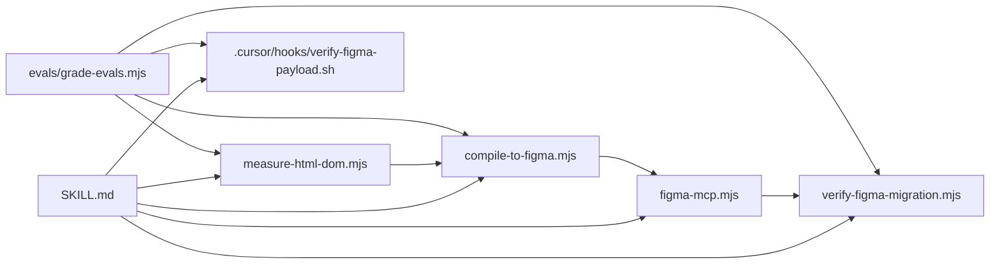

# Graphify Knowledge Graph Report — `tooling-agent-skill-multi_html-to-figma`

## Corpus Summary
- **Files Indexed**: 12
- **Graph Nodes**: 24 (12 files + 12 exported functions)
- **Graph Edges**: 28 (100% `EXTRACTED`, 0 `AMBIGUOUS`)
- **Communities**: 3

## Communities & Cohesion Scores
| Community ID | Name | Cohesion | Primary Nodes |
| :--- | :--- | :--- | :--- |
| `0` | **Skill Contract & Documentation** | `0.94` | `SKILL.md`, `README.md`, `references/architecture-and-tokens.md`, `package.json` |
| `1` | **DOM-to-Figma Compilation & MCP Pipeline** | `0.96` | `scripts/measure-html-dom.mjs`, `scripts/compile-to-figma.mjs`, `scripts/figma-mcp.mjs` |
| `2` | **Verification Gates, Cursor Hooks & Deterministic Evals** | `0.98` | `scripts/verify-figma-migration.mjs`, `.cursor/hooks.json`, `.cursor/hooks/verify-figma-payload.sh`, `evals/grade-evals.mjs` |

## God Nodes (Highest Degree Centrality)
1. **`SKILL.md`** (degree 7) — Central contract orchestrating all 4 pipeline stages, hooks, references, and evals.
2. **`evals/grade-evals.mjs`** (degree 6) — Deterministic evaluation runner exercising Phases 1, 2, 4, and Cursor hooks.
3. **`scripts/compile-to-figma.mjs`** (degree 5) — Bridges measured DOM JSON and chunked `<46 KB` `use_figma` plugin scripts.

## Architecture Flow

